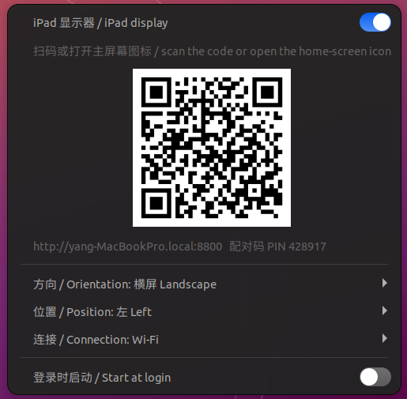

# ipad-display-ubuntu

在 **Ubuntu 22.04 (GNOME / Wayland)** 上把 iPad 当作**第二块显示器**,类似 macOS 的 Sidecar。
*Use an iPad as a second display on Ubuntu 22.04 (GNOME/Wayland), like macOS Sidecar.*

- iPad 端**无需安装任何 App**,只用 Safari;
- 电脑端从**应用程序菜单**或**顶栏菜单**一键开关,不用敲命令;
- 触控操作电脑,拖到 iPad 上的窗口自动铺满;
- 支持 Wi-Fi 和 USB 数据线(个人热点)。

完整原理与图文说明见 [docs/index.html](docs/index.html)。



## 安装(只需一次)

```bash
sudo apt install python3-gi gir1.2-gst-plugins-base-1.0 python3-gst-1.0 \
  gstreamer1.0-pipewire gstreamer1.0-plugins-good gstreamer1.0-plugins-base qrencode
git clone https://github.com/ysonggit/ipad-display-ubuntu ~/ipad-display-ubuntu
~/ipad-display-ubuntu/extension/install.sh
```

然后**注销并重新登录一次**(Wayland 下 GNOME 扩展只在登录时加载)。之后:

- 应用程序菜单里有 **iPad Display / iPad 显示器** 应用(可以搜索,也可以固定到 Dock);
- 顶栏右上角有一个 **iPad 图标**。

> 登录时要选 **Ubuntu(Wayland)** 会话,Xorg 会话不支持。

## 启动:应用程序菜单


按 Super 键打开活动视图,搜索 **iPad**(或在“显示应用程序”里找到 **iPad Display**),点一下:

- 打开 iPad 显示器,并**自动弹出顶栏菜单**,显示二维码和配对码;
- 已经打开时再点,只弹出菜单(可在菜单里关闭);
- 在 Dock 上右键图标 → **关闭**,直接关闭 iPad 显示器。

右键图标选“添加到收藏夹”即可固定在 Dock 上。

## 使用:顶栏 iPad 菜单

点顶栏的 iPad 图标,打开菜单:

| 菜单项 | 作用 |
|---|---|
| **iPad 显示器** 开关 | 打开:创建虚拟显示器并开始推送画面;关闭:显示器消失。图标变亮表示正在运行 |
| 状态行 | 显示当前状态:已关闭 / 正在启动 / 等待扫码 / iPad 已连接(及显示器分辨率) |
| **二维码 + 配对码** | iPad 还没连上时显示,用于第一次配对 |
| **方向** | 横屏 / 竖屏,对应你拿 iPad 的方向 |
| **位置** | iPad 屏幕在笔记本屏幕的 左 / 右 / 上 / 下 |
| **连接** | Wi-Fi / USB(数据线,见下文) |
| **登录时启动** | 打开后每次登录自动运行,插上或打开 iPad 即可用 |

运行中修改方向、位置或连接,会自动重启使其生效(约 2 秒,虚拟显示器会重建一次)。

### 第一次配对

1. 打开菜单里的 **iPad 显示器** 开关;
2. 用 iPad 的**相机**扫菜单里的二维码,点弹出的链接,Safari 自动完成配对;
   不方便扫码时,在 Safari 打开菜单里的地址,输入 **6 位配对码**;
3. 在 Safari 点 **分享 → 添加到主屏幕**。

### 以后每次

打开开关(或开启“登录时启动”),点 iPad 主屏幕上的图标,全屏显示,不用输入任何东西。
然后把窗口拖到 iPad 屏幕上即可。

## 触控操作

| 手势 | 效果 |
|---|---|
| 单指点按 | 鼠标左键点击 |
| 单指拖动 | 按住左键拖动(选文字、移动窗口) |
| 双指拖动 | 滚动 |
| 长按 0.5 秒 | 右键菜单 |

键盘请用电脑本身的键盘。

## 窗口自动铺满 iPad

GNOME 不会在窗口移到另一块显示器时调整大小,窗口拖到较小的 iPad 上会超出屏幕。
同一个扩展会让落到 iPad 上的窗口**自动最大化、铺满 iPad**;不能最大化的窗口和对话框会缩小并移到屏幕内。
拖回笔记本屏幕时,窗口自动恢复原来的大小。

- 适用于:鼠标拖过去松手、`Super+Shift+→/←` 移过去、直接在 iPad 上打开的新窗口;
- 不影响桌面图标等辅助窗口和全屏窗口。

## 横竖屏与黑边

- **方向在菜单里选定,运行中不跟随 iPad 旋转**(Apple Sidecar 也只支持横屏)。
  GNOME 42 在虚拟显示器运行中改变尺寸时会绘制错误(下半部分变灰),所以尺寸在创建时就固定。
  拿反了方向时,iPad 上会提示“旋转到横屏/竖屏”。
- 第一次连接时,iPad 会上报自己的屏幕比例,记在 `~/.config/ipad-display/size.json`;
  **下次打开开关时**按这个比例创建显示器,从而没有黑边。
- 请从**主屏幕图标**打开(全屏);在带地址栏的 Safari 标签页里,上下会留一点黑边。

## USB 数据线连接

iOS 只允许电脑**主动连到** iPad,不允许 iPad 上的 Safari 通过数据线连回电脑。
唯一的通道是 iPad 的 **USB 网络**(个人热点,Linux 驱动 `ipheth`):画面和触控都走数据线,不经过 Wi-Fi。

1. 用数据线连接 iPad,解锁,弹出“信任此电脑”时点**信任**;
2. iPad:设置 → 个人热点 → 打开“允许其他人加入”;
3. 菜单里选 **连接 → USB**。

USB 模式下:只在数据线网络上提供服务(Wi-Fi 上的请求一律拒绝);插线才出现显示器,拔线 5 秒后自动移除;画质默认更高。

连不上时运行诊断,它会逐项检查设备、信任、驱动、网卡、IP、连通性,并给出解决办法:

```bash
~/ipad-display-ubuntu/ipad-display --usb-doctor
```

> **关于雷雳 / USB 3 线:** iPad 的 USB 网络是 USB 2 级别,线缆规格不影响速度,但带宽仍远超画面所需;
> 优势是延迟稳定、不受 Wi-Fi 干扰,还能同时充电。

### 个人热点打不开(灰色 / 被强制关闭)

iOS 只有在**装了 SIM、蜂窝数据已打开、运营商允许热点**时才能开个人热点;
屏幕使用时间里的“蜂窝数据更改 = 不允许”或公司 MDM 描述文件也会禁用它。
**仅 Wi-Fi 版 iPad 没有个人热点**。这些情况下请用 Wi-Fi,或用下面的网线方案。

**以太网转接器方案**(USB-C 口的 iPad 原生支持):

```
iPad ─ USB-C 以太网转接器 ─ 网线 ─ USB-C 以太网转接器 ─ 电脑
```

```bash
ip -br link     # 找到电脑上的以太网网卡名,例如 enx00e04c680001
nmcli connection add type ethernet ifname enx00e04c680001 con-name ipad-eth ipv4.method shared
```

然后在 `~/.config/ipad-display/service.env` 的 `IPAD_DISPLAY_ARGS=` 末尾加上 `--usb-iface enx00e04c680001`,
菜单里选 **连接 → USB**。Ubuntu 会给 iPad 分配地址,只在这根网线上提供服务。

## 高级设置

菜单只管理方向、位置和连接。其他选项写在 `~/.config/ipad-display/service.env` 的 `IPAD_DISPLAY_ARGS=` 这一行末尾,
菜单修改设置时会保留它们。改完后在菜单里关掉再打开开关即可生效。例如更清晰的 HiDPI 画面:

```
IPAD_DISPLAY_ARGS=--orientation landscape --position left --max-edge 2048 --scale 2
```

| 参数 | 默认值 | 说明 |
|---|---|---|
| `--max-edge` | `1600` | 显示器长边像素,越大越清晰但越吃性能 |
| `--scale` | `1` | GNOME 界面缩放,`2` 为 HiDPI(建议配合 `--max-edge 2048`) |
| `--fps` | `30` | 最大帧率 |
| `--quality` | `75` | JPEG 画质 1–100(USB 模式默认 85) |
| `--size` | `auto` | 固定分辨率 `宽x高`,不按 iPad 比例自动计算 |
| `--port` | `8800` | HTTP 端口 |
| `--cookie-days` | `90` | iPad 配对有效天数 |
| `--usb-iface` | | 把指定网卡当作 iPad 的有线连接(网线方案) |

管理已配对设备:

```bash
~/ipad-display-ubuntu/ipad-display --list-devices    # 列出
~/ipad-display-ubuntu/ipad-display --forget          # 全部取消配对
```

## 故障排查

| 现象 | 解决 |
|---|---|
| 顶栏没有 iPad 图标 | 确认已注销并重新登录;`gnome-extensions info ipad-display-helper@ysonggit.github.io` 应显示 ENABLED |
| 开关打开后又自动关闭 | 查看日志:`journalctl --user -u ipad-display -n 50` |
| iPad 上页面打不开 | 把地址里的 `主机名.local` 换成电脑 IP;确认电脑和 iPad 在同一 Wi-Fi |
| 主屏幕图标要求输入配对码 | 输入菜单里显示的配对码一次即可(iOS 主屏幕 App 的 Cookie 独立保存) |
| 画面卡顿 | 改用 USB;或在高级设置里降低 `--max-edge` / `--fps` |
| 有黑边 | 从主屏幕图标打开;第一次连接后关掉再打开开关一次 |

## 命令行用法(可选)

不想用菜单时也可以直接运行脚本,终端会显示二维码和配对码,Ctrl+C 退出:

```bash
cd ~/ipad-display-ubuntu
./ipad-display --position left                         # 横屏
./ipad-display --position left --orientation portrait  # 竖屏
./ipad-display --usb --position left                   # 只走 USB
./ipad-display --help                                  # 全部参数
```

注意不要和菜单启动的服务同时运行(会抢 8800 端口)。

## 卸载

```bash
systemctl --user disable --now ipad-display
rm ~/.config/systemd/user/ipad-display.service
gnome-extensions disable ipad-display-helper@ysonggit.github.io
rm -r ~/.local/share/gnome-shell/extensions/ipad-display-helper@ysonggit.github.io ~/.config/ipad-display
rm ~/.local/share/applications/ipad-display.desktop ~/.local/share/icons/hicolor/scalable/apps/ipad-display.svg
```

## 已知限制

- 依赖 Mutter 的私有 D-Bus 接口(`ScreenCast.RecordVirtual` / `RemoteDesktop`),在 GNOME 42 上验证,其他版本可能失效。
- 运行中不能旋转(见“横竖屏与黑边”)。
- 使用 MJPEG(本机没有 H.264 编码器),带宽比 H.264 高。
- 无键盘透传、无音频、无 Apple Pencil 压感。
- 使用明文 HTTP:Cookie 在不可信的 Wi-Fi 上可能被嗅探,请只在家庭网络或 USB 连接下使用。
- 配对记录保存在 `~/.config/ipad-display/devices.json`(仅存哈希);配对码连续错 5 次会锁定该来源 5 分钟。

## License

MIT
